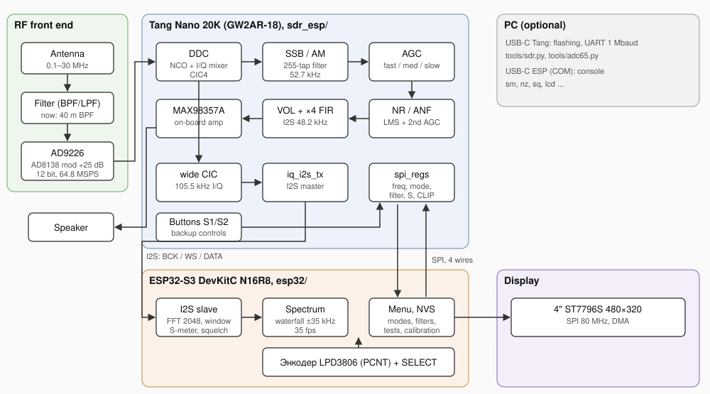
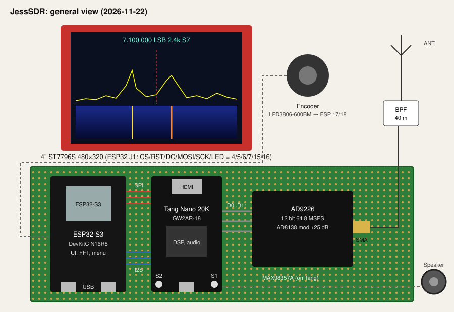
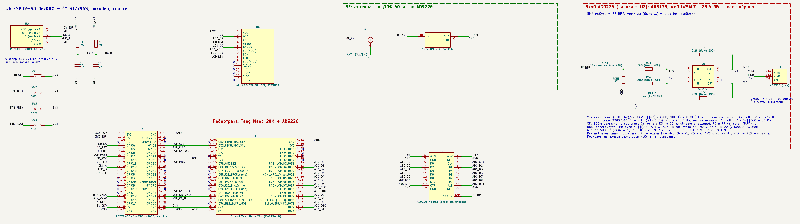
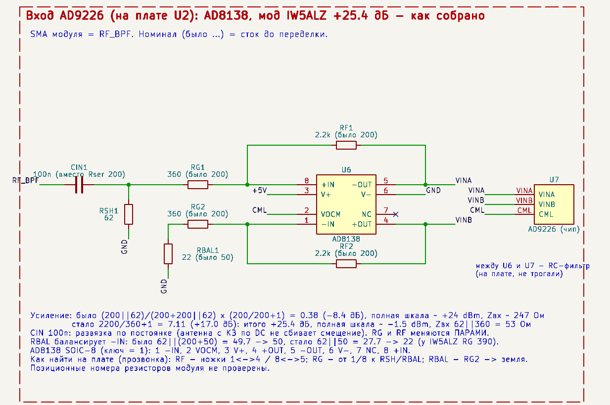

# JessSDR

[Русская версия](README.ru.md)

A direct-sampling HF receiver for **0.1–30 MHz** built from cheap parts:
a Sipeed Tang Nano 20K FPGA, an AD9226 ADC module and an ESP32-S3 with a
4" display. Named after Jessica, the author's cat (she is on the boot splash).

## Features

- **Coverage 0.1–30 MHz**, direct sampling at 64.8 MSPS (Nyquist 32.4 MHz).
  The band is set by the filter in front of the ADC: a 40 m BPF is fitted
  now. Use a 30 MHz low-pass filter to cover the whole range.
- **Modes:** LSB, USB, AM, CW. **AUTO** picks the mode from the IARU region 1
  band plan: AM on LW/MW, the broadcast bands and CB; LSB below 10 MHz, USB
  above and on 60 m.
- **Filters:** SSB 1.8 / 2.4 / 2.7 / 3.0 kHz with ±1 kHz IF shift, CW
  1000 / 500 / 250 Hz at a 700 Hz pitch. All filters run in one programmable
  255-tap complex FIR in the FPGA.
- **AGC** fast / medium / slow. **NR** (LMS noise reduction, 4 levels) and
  **ANF** (automatic notch). **Squelch** works on the passband SNR.
- **Display:** spectrum and waterfall ±35 kHz, 35 fps, in three views
  (spectrum, waterfall, or both with an adjustable split). FFT 2048 with a
  window of OFF / Hann / Blackman-Harris. The picture scrolls smoothly when
  you retune.
- **S-meter** from the FFT passband power. An ADC overload indicator
  (CLIP) appears in the header.
- **Service tools:** SPI/I2S link self-tests, a noise test (50 Ω load vs
  antenna, no PC needed) and a reference-crystal calibration in ppm.
  Settings are kept in NVS.
- **Tuning** 10 Hz – 1 MHz steps with an optical encoder (600 PPR) and
  speed-dependent acceleration.

## Block diagram

The **Tang Nano 20K** (`sdr_esp/`) runs the whole radio path:
- ADC → DDC (NCO + I/Q mixer, CIC4 to 52.7 kHz) → SSB/AM demodulator with
  the programmable filter → AGC → NR/ANF → volume → ×4 polyphase FIR
  interpolator → I2S → the on-board MAX98357A amplifier → speaker.
- A second, wide CIC output (105.5 kHz I/Q) goes to the ESP32 over I2S.
- The ESP controls the FPGA through an SPI register file: frequency, mode,
  filter taps, AGC, volume, NR, ADC peak and clip counters.

The **ESP32-S3** (`esp32/`, ESP-IDF 6.0) does the user interface: FFT,
spectrum and waterfall, S-meter, squelch, menu, encoder and the 4" ST7796S
display (SPI at 80 MHz with DMA).

## General view (2026-11-22)

Everything sits on one perfboard. From left to right: the ESP32-S3, the
Tang Nano 20K, then the AD9226 with its SMA input. The ESP–Tang link wires
are straight jumpers between neighbouring header rows. The display sits
above the boards.

## Schematic

The whole receiver as built is one KiCad sheet: antenna and BPF, the AD9226
with the modified AD8138 input stage, the Tang, the ESP32, the display,
encoder, buttons and the ESP supply. It is generated by
`hardware/gen_schematic.py`.
**PDF: [`hardware/jesssdr/jesssdr.pdf`](hardware/jesssdr/jesssdr.pdf)**

### Hardware

| Part | Notes |
|---|---|
| Sipeed Tang Nano 20K | GW2AR-LV18QN88C8/I7, 27 MHz crystal, on-board MAX98357A |
| AD9226 module | 12 bit, clocked at 64.8 MSPS from the Tang PLL. AD8138 front end modified after IW5ALZ (RF 2.2k, RG 360, RBAL 22, C 100n): **+25 dB** gain |
| ESP32-S3-DevKitC N16R8 | 16 MB flash, 8 MB octal PSRAM; the debug console is on UART0 (COM port) |
| 4" SPI TFT ST7796S | 480×320, 3.3 V |
| LPD3806-600BM | optical encoder, 5 V, open collector with 4.7k pull-ups to 3.3 V |
| 40 m BPF | in front of the ADC SMA input |

### AD9226 module modification (+25 dB)

The stock AD9226 module is built for a ±5 V input. Its AD8138
differential driver has a gain of only about 0.38 (−8.4 dB), so full scale
is about +24 dBm and weak HF signals sink into the ADC noise. Following
IW5ALZ ([hackaday.io/project/186329](https://hackaday.io/project/186329),
logs 213303/213304), four parts on the module's AD8138 stage were changed:

| Part | Stock | Modified | Why |
|---|---|---|---|
| Rser (input series) | 200 Ω | **100 nF** capacitor | DC block: an antenna that is DC-shorted no longer shifts the bias |
| RG (×2) | 200 Ω | **360 Ω** (IW5ALZ: 390) | gain-setting resistor, sets the input impedance |
| RF (×2) | 200 Ω | **2.2 kΩ** | feedback, gain = RF/RG + 1 |
| RBAL | 50 Ω | **22 Ω** | re-balances the −IN side: 62 ‖ 50 = 27.7 Ω |

The input stage as built, cut from the KiCad schematic
([`hardware/jesssdr/jesssdr.pdf`](hardware/jesssdr/jesssdr.pdf)). The
notes on it are in Russian: «было» means "stock".

Results:
- Gain = 2200/360 + 1 = 7.11 (+17.0 dB). That is **+25.4 dB** better than
  stock.
- Full scale is now about −1.5 dBm.
- Input impedance is 62 ‖ 360 ≈ 53 Ω.

RG and RF must be changed in pairs, on both halves of the differential
stage. To find the parts by probing the AD8138 (SOIC-8: 1 −IN, 4 +OUT,
5 −OUT, 8 +IN): RF sits between pins 1↔4 and 8↔5, RG runs from pins 1/8
towards the input, and RBAL goes from the second RG to ground. The
module's R-numbers are not verified. The modification is drawn as built
in the "AD9226 input" frame of the schematic.

The modification was done on 2026-11-07, and reception became much better.
The receiver works with the 40 m BPF and no LNA.

## Controls

| Where | Action |
|---|---|
| Encoder | tuning; menu cursor; edits values (volume, squelch, IF shift, ppm) |
| Tang S1 short / long | main screen: tuning step / volume; in menus: SELECT |
| Tang S2 short / long | main screen: squelch / menu; in menus: BACK / exit to main |

Menu tree: **Mode**, **Audio** (NR, Level, Filter, Shift, AGC, Volume,
Squelch), **Display** (View, Range, Window, Smooth, Retune, WF speed, FPS),
**System** (SPI link test, I2S link test, Noise test, Freq cal), **Source**
(FPGA or simulated signal).

## Build and flash

    cd sdr_esp && ./build && ./flash flash     # Tang (Gowin EDA, openFPGALoader)
    cd esp32 && ./build.sh && ./flash.sh       # ESP32-S3 (ESP-IDF 6.0)

To flash tested images without building, see
[`releases/README.md`](releases/README.md).

Testbenches use iverilog, one per module, in `*/sim/`, e.g.

    iverilog -g2012 -o sim/tb_ddc sim/tb_ddc.v ddc.v && vvp sim/tb_ddc

## Repository layout

| Folder | Contents |
|---|---|
| `sdr_esp/` | Tang firmware for the ESP32 UI (current) |
| `esp32/` | ESP32-S3 UI (ESP-IDF 6.0) |
| `sdr/` | Tang-only receiver: ILI9341 display driven by the Tang, no ESP (tag `working-2026-11-07`) |
| `adc65/`, `adc_test/` | ADC bring-up: oscilloscope on the TFT, sample dump over UART |
| `tools/` | PC scripts: `adc65.py` (ADC analysis), `sdr.py` (receiver control over UART) |
| `hardware/` | single KiCad schematic and its generator |
| `releases/` | hardware-tested images (`.fs` + `.bin`) with sha256 |
| `docs/` | datasheets, design notes, images for this README |
| `tft_test/`, `zx_demo/` | display tests and a ZX Spectrum-style demo (side projects) |

## Versions

| Tag | What |
|---|---|
| `working-2026-11-07` | Tang only: SSB receiver, spectrum and waterfall on a 2.8" ILI9341 |
| `working-2026-11-10` | first ESP32-S3 version: 4" display, menu, NR/ANF, AM |
| `working-2026-11-22` | programmable SSB filter, CW, AGC/volume, ×4 audio interpolator, squelch, noise test, spectrum/waterfall views |

After the last release (v8, not yet in a release): ADC clip counter, an
adjustable spectrum/waterfall split, waterfall speed, and an S-meter
calibration command in the console.

**Next:** a CIC compensation filter (CFIR) in the FPGA for a flat spectrum
and a dBm scale ([`docs/flat_spectrum_plan.md`](docs/flat_spectrum_plan.md)).
Work log and plan: [`PLAN.md`](PLAN.md).
