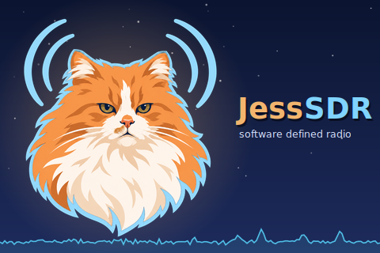
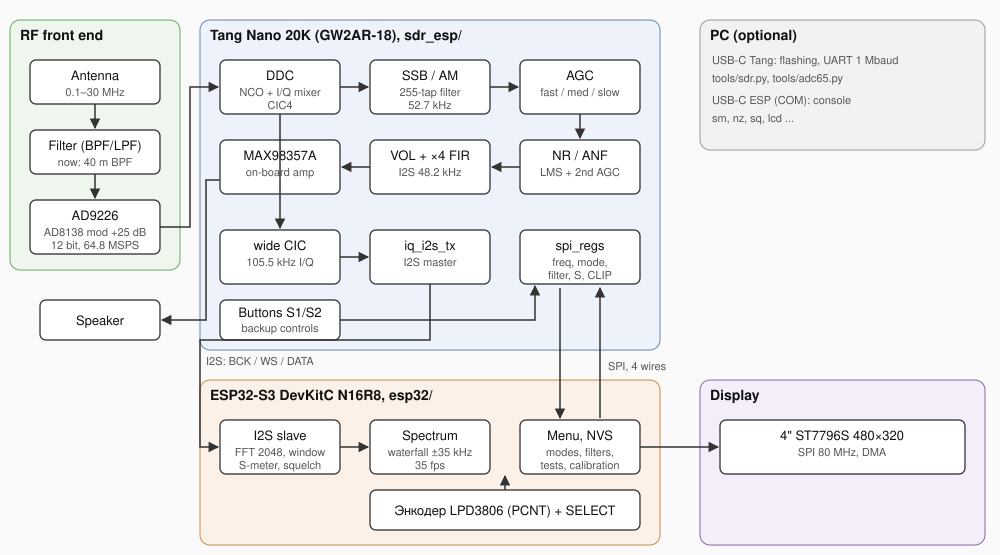
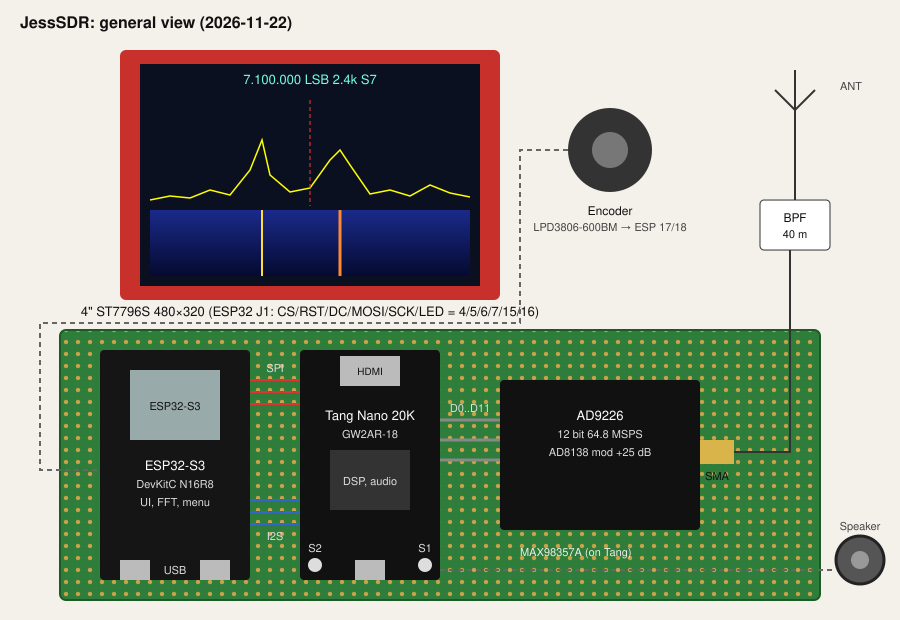
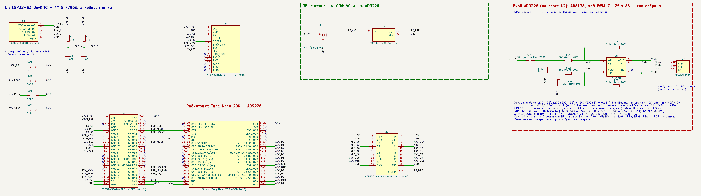

# JessSDR

[English version](README.md)

КВ-приёмник с прямой оцифровкой на **0.1–30 МГц** из недорогих модулей:
ПЛИС Sipeed Tang Nano 20K, модуль АЦП AD9226 и ESP32-S3 с 4" дисплеем.
Назван в честь кошки Джессики (она на заставке).

## Возможности

- **Диапазон 0.1–30 МГц**, прямая оцифровка 64.8 MSPS (Найквист 32.4 МГц).
  Рабочую полосу задаёт фильтр перед АЦП: сейчас стоит ДПФ на 40 м. Чтобы
  принимать весь диапазон, нужен ФНЧ на 30 МГц.
- **Виды модуляции:** LSB, USB, AM, CW. Режим **AUTO** выбирает модуляцию по
  бэнд-плану IARU (1-й район): AM на ДВ/СВ, на вещательных КВ-диапазонах и
  на CB; ниже 10 МГц LSB, выше и на 60 м USB.
- **Фильтры:** SSB 1.8 / 2.4 / 2.7 / 3.0 кГц со сдвигом ПЧ ±1 кГц, CW
  1000 / 500 / 250 Гц при тоне 700 Гц. Все фильтры работают на одном
  программируемом комплексном КИХ-фильтре на 255 отводов в ПЛИС.
- **АРУ** быстрая / средняя / медленная. **NR** (LMS-шумоподавление,
  4 уровня) и **ANF** (автоматический режекторный фильтр). **Шумодав**
  работает по отношению сигнал/шум в полосе.
- **Экран:** спектр и водопад ±35 кГц, 35 кадров/с, три вида (спектр,
  водопад или оба с настраиваемым делением). БПФ 2048, окно OFF / Hann /
  Blackman-Harris. При перестройке картинка плавно сдвигается.
- **S-метр** считается по мощности БПФ в полосе. В заголовке есть
  индикатор перегрузки АЦП (CLIP).
- **Сервис:** самотесты связи SPI/I2S, тест шумов (нагрузка 50 Ом против
  антенны, без ПК), калибровка опорного кварца в ppm. Настройки хранятся
  в NVS.
- **Перестройка** шагом от 10 Гц до 1 МГц оптическим энкодером
  (600 имп/об) с ускорением при быстром вращении.

## Блок-схема

**Tang Nano 20K** (`sdr_esp/`) выполняет весь радиотракт:
- АЦП → DDC (NCO + смеситель I/Q, CIC4 до 52.7 кГц) → демодулятор SSB/AM с
  программируемым фильтром → АРУ → NR/ANF → громкость → полифазный
  интерполятор ×4 → I2S → встроенный усилитель MAX98357A → динамик.
- Второй, широкий выход CIC (I/Q 105.5 кГц) идёт по I2S на ESP32.
- ESP управляет ПЛИС через регистры по SPI: частота, режим, отводы фильтра,
  АРУ, громкость, NR, пик и счётчик перегрузок АЦП.

**ESP32-S3** (`esp32/`, ESP-IDF 6.0) отвечает за интерфейс: БПФ, спектр и
водопад, S-метр, шумодав, меню, энкодер и 4" дисплей ST7796S (SPI 80 МГц,
DMA).

## Общий вид (2026-11-22)

Всё собрано на одной макетной плате, слева направо: ESP32-S3, Tang Nano 20K,
затем AD9226 со входом SMA. Провода связи ESP–Tang идут прямыми перемычками
между соседними рядами штырей. Дисплей стоит над платами.

## Схема

Весь приёмник в том виде, как он собран, нарисован на одном листе KiCad:
антенна и ДПФ, AD9226 с доработанным входным каскадом AD8138, Tang, ESP32,
дисплей, энкодер, кнопки и питание ESP. Схему генерирует скрипт
`hardware/gen_schematic.py`.
**PDF: [`hardware/jesssdr/jesssdr.pdf`](hardware/jesssdr/jesssdr.pdf)**

### Железо

| Модуль | Примечание |
|---|---|
| Sipeed Tang Nano 20K | GW2AR-LV18QN88C8/I7, кварц 27 МГц, встроенный MAX98357A |
| Модуль AD9226 | 12 бит, тактирование 64.8 MSPS от PLL Tang. Входной каскад AD8138 доработан по IW5ALZ (RF 2.2к, RG 360, RBAL 22, C 100н): усиление **+25 дБ** |
| ESP32-S3-DevKitC N16R8 | 16 МБ flash, 8 МБ octal PSRAM; отладочная консоль на UART0 (COM-порт) |
| 4" SPI TFT ST7796S | 480×320, 3.3 В |
| LPD3806-600BM | оптический энкодер, 5 В, открытый коллектор с подтяжкой 4.7к к 3.3 В |
| ДПФ 40 м | перед входом SMA АЦП |

### Доработка модуля AD9226 (+25 дБ)

Штатный модуль AD9226 рассчитан на вход ±5 В. Его дифференциальный
драйвер AD8138 работает с усилением всего около 0.38 (−8.4 дБ), полная
шкала около +24 dBm, и слабые КВ-сигналы тонут в шумах АЦП. По примеру
IW5ALZ ([hackaday.io/project/186329](https://hackaday.io/project/186329),
логи 213303/213304) в каскаде AD8138 на модуле заменены четыре детали:

| Деталь | Было | Стало | Зачем |
|---|---|---|---|
| Rser (последовательный на входе) | 200 Ом | **конденсатор 100 нФ** | развязка по постоянному току: антенна, замкнутая по DC, больше не сбивает смещение |
| RG (×2) | 200 Ом | **360 Ом** (у IW5ALZ 390) | задаёт усиление и входное сопротивление |
| RF (×2) | 200 Ом | **2.2 кОм** | обратная связь, усиление = RF/RG + 1 |
| RBAL | 50 Ом | **22 Ом** | заново балансирует сторону −IN: 62 ‖ 50 = 27.7 Ом |

Результат:
- Усиление 2200/360 + 1 = 7.11 (+17.0 дБ), то есть на **+25.4 дБ** больше
  штатного.
- Полная шкала теперь около −1.5 dBm.
- Входное сопротивление 62 ‖ 360 ≈ 53 Ом.

RG и RF меняются парами, в обеих половинах дифференциального каскада.
Найти детали можно прозвонкой от ножек AD8138 (SOIC-8: 1 −IN, 4 +OUT,
5 −OUT, 8 +IN): RF стоят между ножками 1↔4 и 8↔5, RG идут от ножек 1/8 ко
входу, RBAL идёт от второго RG на землю. Позиционные номера резисторов на
модуле не проверены. Доработка в собранном виде нарисована на схеме, в
рамке «Вход AD9226».

Доработка сделана 2026-11-07, приём стал намного лучше. Приёмник
работает с ДПФ 40 м без МШУ.

## Управление

| Где | Действие |
|---|---|
| Энкодер | перестройка частоты; курсор в меню; изменение значений (громкость, шумодав, сдвиг ПЧ, ppm) |
| Tang S1 коротко / долго | на главном экране: шаг / громкость; в меню: SELECT |
| Tang S2 коротко / долго | на главном экране: шумодав / меню; в меню: BACK / выход на главный экран |

Меню: **Mode**, **Audio** (NR, Level, Filter, Shift, AGC, Volume, Squelch),
**Display** (View, Range, Window, Smooth, Retune, WF speed, FPS), **System**
(SPI link test, I2S link test, Noise test, Freq cal), **Source** (ПЛИС или
имитация сигнала).

## Сборка и прошивка

    cd sdr_esp && ./build && ./flash flash     # Tang (Gowin EDA, openFPGALoader)
    cd esp32 && ./build.sh && ./flash.sh       # ESP32-S3 (ESP-IDF 6.0)

Как прошить проверенные образы без сборки, описано в
[`releases/README.md`](releases/README.md).

Тестбенчи для iverilog лежат в `*/sim/`, по одному на модуль, например:

    iverilog -g2012 -o sim/tb_ddc sim/tb_ddc.v ddc.v && vvp sim/tb_ddc

## Структура репозитория

| Папка | Что там |
|---|---|
| `sdr_esp/` | прошивка Tang для работы с ESP32 (текущая) |
| `esp32/` | интерфейс на ESP32-S3 (ESP-IDF 6.0) |
| `sdr/` | приёмник только на Tang: дисплей ILI9341 на Tang, без ESP (тег `working-2026-11-07`) |
| `adc65/`, `adc_test/` | запуск АЦП: осциллограф на TFT, дамп отсчётов по UART |
| `tools/` | скрипты для ПК: `adc65.py` (анализ АЦП), `sdr.py` (управление приёмником по UART) |
| `hardware/` | единая схема KiCad и её генератор |
| `releases/` | проверенные на железе образы (`.fs` + `.bin`) с sha256 |
| `docs/` | документация на модули, заметки, картинки для README |
| `tft_test/`, `zx_demo/` | тесты дисплея и демо в стиле ZX Spectrum (побочные проекты) |

## Версии

| Тег | Что |
|---|---|
| `working-2026-11-07` | только Tang: SSB-приёмник, спектр и водопад на 2.8" ILI9341 |
| `working-2026-11-10` | первая версия с ESP32-S3: 4" дисплей, меню, NR/ANF, AM |
| `working-2026-11-22` | программируемый SSB-фильтр, CW, АРУ/громкость, интерполятор звука ×4, шумодав, тест шумов, виды спектр/водопад |

После последнего релиза (v8, в релиз ещё не вошла): счётчик перегрузок
АЦП, настраиваемое деление спектр/водопад, скорость водопада и команда
калибровки S-метра в консоли.

**Дальше:** компенсирующий фильтр CIC (CFIR) в ПЛИС, чтобы спектр был ровным
и со шкалой в дБм ([`docs/flat_spectrum_plan.md`](docs/flat_spectrum_plan.md)).
План и журнал работ: [`PLAN.md`](PLAN.md).
